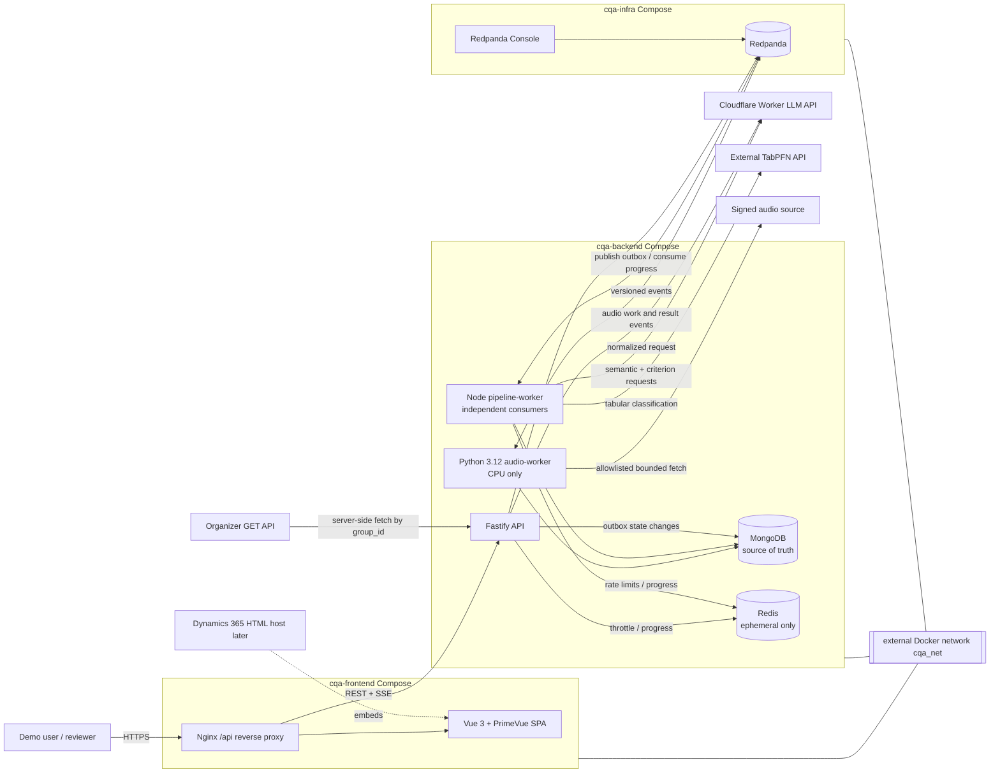

# Conversation Quality Analytics (CQA) Architecture

**Status:** implementation-ready blueprint  
**Target:** Freedom Broker Hackathon 2026, 24-hour build  
**Authoritative inputs:** `CQA_Hackathon_Student_Guide_v3 1.pdf`, `CQA_Chat_Quality_Checklist 1.pdf`, and `invoke.json`

This document fixes the foundational decisions for the CQA platform. It intentionally contains no application source code. The root `Makefile` is the sole executable artifact in this architecture package.

## 1. Architecture Summary

CQA is a modular TypeScript monorepo deployed on one Docker host as three independent Compose projects joined to the external network `cqa_net`:

- `cqa-infra`: MongoDB, Redis, Redpanda, and Redpanda Console.
- `cqa-backend`: a Fastify API, a Node.js pipeline worker containing independently registered consumers, and a CPU-only Python audio worker.
- `cqa-frontend`: a Vue 3 static application served by Nginx, which proxies `/api` to Fastify.

MongoDB is the system of record. Redpanda coordinates asynchronous stages through identifier-only events. A MongoDB transactional outbox prevents state changes from being committed without a durable publication intent; the design promises at-least-once delivery with idempotent processing, not end-to-end exactly once. Redis contains only expiring operational state.

The import pipeline preserves the organizer envelope, transcript text, timestamps, sequence, duplicate source entries, and protected audio URL. Normalization adds stable message IDs. Deterministic metadata and scoring never rely on LLM arithmetic. Semantic extraction and eight independent criterion evaluations use a normalized Cloudflare Worker gateway. TabPFN proposes one action from the fixed taxonomy; documented deterministic rules provide cold-start fallback and safety overrides. Reports, appeals, review decisions, and checklist versions are immutable revisions.

Frontend and backend are coupled only by generated OpenAPI types and documented event semantics. The UI requires no login for the demo, distinguishes appellant and reviewer actions, and keeps page modules independent of the shell so that they can later run in a Dynamics 365 HTML web resource.

### Core invariants

1. Source data is append-only; re-import is idempotent by dataset group, conversation ID, and source checksum.
2. `conversations._id` is the REST resource ID. The source `conversation_id` remains a displayed external identifier and is unique only with `dataset_group_id`.
3. Stable message IDs are `<conversation_id>:m<zero-based-source-index-padded-to-at-least-four-digits>`.
4. Audio URLs are secrets: encrypted or access-restricted at rest, redacted from logs, and absent from events and frontend JSON.
5. Every evaluation binds an immutable checklist version, model alias/resolved model ID, prompt versions, and source conversation revision.
6. A review never edits an AI result. It creates a decision, revised report, recalculated score, and, when needed, revised classification.
7. Severe violation is a Boolean flag separate from numerical score. A confirmed violation deterministically yields `COMPLIANCE_REVIEW`.
8. Live external AI is optional for the demo: schema-valid fixtures drive the same adapters and pipeline.

## 2. Architecture Diagram



No browser request reaches MongoDB, Redis, Redpanda, Cloudflare, TabPFN, or the organizer directly.

## 3. Processing Sequence Diagram

```mermaid
sequenceDiagram
    autonumber
    actor U as User
    participant W as Vue web
    participant A as Fastify API
    participant M as MongoDB
    participant O as Outbox publisher
    participant K as Redpanda
    participant P as Pipeline worker
    participant L as Cloudflare LLM
    participant AU as Audio worker
    participant T as TabPFN

    U->>W: Upload invoke.json or fetch group_id
    W->>A: POST /api/v1/datasets/import or /fetch
    A->>A: Validate envelope, records, size, media types
    A->>M: Store raw_import checksum + upsert source records + outbox
    A-->>W: 202 dataset/job IDs + status URL
    O->>M: Claim unpublished outbox records
    O->>K: cqa.conversation.ingested.v1 (IDs only)
    O->>M: Mark outbox published

    K->>P: Ingested event
    P->>M: Claim idempotency key; normalize messages/times
    P->>M: Save conversation revision + status + outbox
    P->>K: cqa.conversation.normalized.v1
    K->>P: Normalized event
    par deterministic and semantic metadata
      P->>M: Calculate deterministic metadata
      P->>L: One structured semantic extraction request
      L-->>P: Schema-bound metadata + evidence + usage
      P->>M: Persist combined metadata + outbox
    and audio when present
      K->>AU: cqa.conversation.normalized.v1
      AU->>AU: Safe fetch, decode, VAD, metrics
      AU->>M: Persist complete/unavailable/skipped result + outbox
      AU->>K: cqa.audio.analyzed.v1
    end
    P->>K: cqa.metadata.extracted.v1

    U->>W: Select conversations + checklist version
    W->>A: POST /api/v1/evaluations
    A->>M: Create run, processing job, outbox
    A-->>W: 202 evaluation/job IDs
    A->>K: cqa.evaluation.requested.v1
    K->>P: Evaluation request
    P->>M: Load immutable checklist and conversation revision
    loop each enabled criterion, max 4 concurrent
      P->>K: cqa.criterion.requested.v1
      K->>P: Criterion work item
      P->>L: Criterion-specific normalized request
      L-->>P: Validated answer, explanation, evidence, usage
      P->>M: Insert idempotent criterion result + outbox
      P->>K: cqa.criterion.completed.v1
    end
    P->>M: Confirm all required criterion IDs completed
    P->>P: Deterministic score aggregation
    P->>M: Persist run completion + outbox
    P->>K: cqa.evaluation.completed.v1
    P->>K: cqa.classification.requested.v1
    K->>P: Classification work item
    P->>T: Stable feature vector
    alt provider valid and confidence acceptable
      T-->>P: Prediction + confidence
    else timeout, invalid result, or cold start
      P->>P: Deterministic fallback classifier
    end
    P->>P: Apply severe-violation and priority overrides
    P->>M: Persist raw + final classification and report + outbox
    P->>K: cqa.action.classified.v1
    P->>K: cqa.report.generated.v1
    K-->>A: Projection/progress consumers update read status
    A-->>W: SSE job event; client refetches report
    W-->>U: Evidence-linked immutable report

    Note over K,P: On retriable failure, exponential backoff and persisted attempts
    Note over K,P: After limit, failure record + cqa.deadletter.v1
    Note over M,P: Restart resumes from committed offsets and Mongo processing keys; completed stages are not repeated
```

Audio has a bounded wait. Report generation proceeds after the configurable deadline with audio state `unavailable`, `skipped`, or `timed_out`; a later audio result can be shown as supplemental metadata but does not mutate an existing report.

## 4. Full Repository Structure

The implementation repository will use this structure. Empty directories are not required; each appears when its first owned file is implemented.

```text
cqa-platform/
├── frontend/
│   ├── src/
│   │   ├── app/
│   │   │   ├── App.vue
│   │   │   ├── router.ts
│   │   │   ├── providers.ts
│   │   │   └── i18n.ts
│   │   ├── pages/
│   │   │   ├── dashboard/{DashboardPage.vue,components/,composables/}
│   │   │   ├── conversations/{ConversationsPage.vue,components/,composables/}
│   │   │   ├── conversation-detail/{ConversationDetailPage.vue,components/,composables/}
│   │   │   ├── evaluation-report/{EvaluationReportPage.vue,components/,composables/}
│   │   │   ├── checklist-builder/{ChecklistBuilderPage.vue,components/,composables/}
│   │   │   ├── appeals/{AppealsPage.vue,components/,composables/}
│   │   │   ├── appeal-review/{AppealReviewPage.vue,components/,composables/}
│   │   │   └── processing-monitor/{ProcessingMonitorPage.vue,components/,composables/}
│   │   ├── components/{AppShell/,Navigation/,ErrorBoundary/}
│   │   ├── shared/
│   │   │   ├── components/{AsyncState/,EmptyState/,ScoreBadge/,RoleTag/}
│   │   │   ├── composables/{useSseJob/,useEvidenceNavigation/}
│   │   │   ├── constants/
│   │   │   ├── formatters/
│   │   │   └── styles/{tokens.css,base.css}
│   │   ├── api/{client.ts,generated.ts,queries.ts,errors.ts}
│   │   └── styles/
│   ├── tests/{unit/,integration/,e2e/}
│   ├── public/
│   ├── nginx.conf
│   ├── Dockerfile
│   ├── package.json
│   ├── tsconfig.json
│   └── vite.config.ts
├── backend/
│   ├── src/
│   │   ├── apps/
│   │   │   ├── api/{server.ts,routes.ts,plugins.ts}
│   │   │   └── worker/{main.ts,consumer-registry.ts,outbox-publisher.ts}
│   │   ├── modules/
│   │   │   ├── dataset-import/
│   │   │   ├── conversation-ingestion/
│   │   │   ├── conversation-normalization/
│   │   │   ├── conversation-query/
│   │   │   ├── deterministic-metadata/
│   │   │   ├── semantic-metadata/
│   │   │   ├── audio-analysis/
│   │   │   ├── checklist-management/
│   │   │   ├── criterion-evaluation/
│   │   │   ├── evaluation-orchestration/
│   │   │   ├── score-calculation/
│   │   │   ├── action-classification/
│   │   │   ├── report-generation/
│   │   │   ├── appeals/
│   │   │   ├── review-decisions/
│   │   │   ├── dashboard-analytics/
│   │   │   └── processing-status/
│   │   ├── infrastructure/
│   │   │   ├── mongodb/{client.ts,indexes.ts,transaction.ts}
│   │   │   ├── redis/{client.ts,keys.ts}
│   │   │   ├── kafka/{client.ts,envelope.ts,retry.ts}
│   │   │   ├── http/{cloudflare-llm.ts,tabpfn.ts,organizer.ts}
│   │   │   ├── observability/{logger.ts,tracing.ts,metrics.ts}
│   │   │   └── security/{redaction.ts,safe-url.ts}
│   │   ├── contracts/{api/,events/,ai/,classification/}
│   │   └── config/{env.schema.ts,load-config.ts}
│   ├── audio-worker/
│   │   ├── src/{main.py,consumer.py,audio_fetch.py,analysis.py,schemas.py}
│   │   ├── tests/
│   │   ├── pyproject.toml
│   │   └── Dockerfile
│   ├── tests/{fixtures/,contract/,integration/,replay/}
│   ├── Dockerfile
│   ├── package.json
│   └── tsconfig.json
├── infra/
│   ├── redpanda/{bootstrap-topics.sh,redpanda.yml}
│   ├── mongodb/{init-indexes.js}
│   ├── redis/{redis.conf}
│   └── nginx/{default.conf}
├── docs/{architecture.md,openapi/,events/,demo-runbook.md}
├── docker-compose.infra.yml
├── docker-compose.backend.yml
├── docker-compose.frontend.yml
├── Makefile
├── .env.example
├── README.md
└── package.json
```

Within a backend module, only needed folders are created: `domain/` contains dependency-free entities and ports, `application/` contains one use case per file, `adapters/http/`, `adapters/events/`, and `adapters/persistence/` implement ports, `schemas/` owns TypeBox/persistence shapes, and `tests/` owns module tests. Domain and application code may not import Fastify, KafkaJS, the MongoDB driver, ioredis, Undici, or provider SDKs. Module `index.ts` files expose the small public surface; cross-module imports use these surfaces, never another module's adapter.

Every page-specific Vue component has its own folder and `index.ts`. Components under one page cannot be imported by an unrelated page. Only `shared/` may cross page boundaries.

## 5. Module Responsibility Matrix

Abbreviations: `R/W` means MongoDB read/write; HTTP routes are relative to `/api/v1`.

| Module | Responsibility and inputs | Outputs / routes | Persistence | Events and failure behavior | Primary tests |
|---|---|---|---|---|---|
| dataset-import | Accept multipart JSON or organizer `group_id`; validate envelope, count, enum values, and limits | `POST /datasets/import`, `POST /datasets/fetch`, `GET /datasets`; dataset/job IDs | W `raw_imports`, `datasets`, `processing_jobs`, `outbox_events`; R existing checksums | Produces ingested outbox work through ingestion; organizer errors are persisted, retried only for timeout/429/5xx | malformed envelope, count mismatch, safe fetch, same checksum re-import |
| conversation-ingestion | Convert validated records into immutable source revisions without losing fields | Internal ingest result | R `raw_imports`; W `conversations`, jobs, outbox | Produces `conversation.ingested`; duplicate composite key becomes idempotent success unless checksum conflicts | 65-record import, duplicate import, source duplicate preservation |
| conversation-normalization | Add stable IDs, normalized times, timestamp flags, source revision | Internal normalized conversation | R/W `conversations`; W jobs/outbox | Consumes ingested; produces normalized; invalid individual timestamp is flagged rather than dropping record | stable IDs, equal times, chat/voice timestamps |
| conversation-query | Read-only conversation, transcript, metadata, report-history and controlled audio views | Conversation routes and media response | R conversations, metadata, audio, reports; never returns audio URL | No events; 404/409/416 use standard errors; media proxy fails closed | filters, redaction, transcript order, range requests |
| deterministic-metadata | Calculate exact role, turn, duration, latency, ratio, handoff and quality metrics | Metadata fragment | R conversations; W `conversation_metadata` and outbox | Consumes normalized; contributes to metadata extracted only after semantic terminal state | turn boundaries, p1-ru-001 37 seconds, invalid timestamps |
| semantic-metadata | One structured multilingual extraction per conversation | Intent/compliance/sentiment metadata with evidence | R conversations; W metadata, jobs, outbox | Consumes normalized; bounded retry; schema invalidity retried then DLQ; fixture mode supported | RU/KZ/EN fixtures, hallucinated message ID rejection |
| audio-analysis | Coordinate optional audio states and expose safe playback metadata | `GET /conversations/:id/audio` through query module | R conversation secret; R/W `audio_metrics`; W jobs/outbox | Audio worker consumes normalized voice records and produces analyzed terminal event; deadline yields explicit terminal state | inaccessible URL, non-media response, timeout, noisy duplicate transcript |
| checklist-management | Create checklist identity and immutable versions; activate pointer | Checklist CRUD/version/activate routes | R/W `checklists`, `checklist_versions`; W outbox as needed | No required public topic; optimistic version conflict is 409 | initial eight criteria, arbitrary new criterion, immutability |
| criterion-evaluation | Evaluate one data-driven criterion against operator work | Criterion result | R conversations/checklist version/metadata; W `criterion_evaluations`, jobs, outbox | Consumes criterion requested; produces criterion completed; retries do not duplicate success | all answer types, N/A constraints, missing-action range |
| evaluation-orchestration | Start run, fan out criteria, detect completion, resume partial runs | `POST /evaluations`, `GET /evaluations/:id`, `POST /evaluations/:id/rerun` | R checklist/conversation/results; W `evaluation_runs`, jobs, outbox | Consumes evaluation requested/completed criteria; produces requested/completed/classification requested | parallel max, restart, repeated run, disabled criteria |
| score-calculation | Validate answers and calculate weighted criteria, sections, final score | Pure score result embedded in report | No direct adapter; caller persists | Invoked after all required criteria or review; arithmetic never comes from LLM | N/A redistribution, zero denominator, 77.06, rounding |
| action-classification | Assemble stable feature vector; call TabPFN; apply fallback and overrides | Action routes and analytics | R metadata/evaluations/audio; W `classification_results`, outbox | Consumes classification requested; produces action classified; provider failure falls back deterministically | encodings, missing data, severe override, timeout |
| report-generation | Snapshot original or finalized evaluation and classification | `GET /reports/:id`, report-history route | R evaluation/classification/review; W immutable `reports`, outbox | Consumes action classified/appeal resolved; produces report generated | evidence integrity, revision chain, old version unchanged |
| appeals | Submit/list a criterion-level dispute | Appeal create/list/detail routes | R criterion/report; W `appeals` | State transitions OPEN to UNDER_REVIEW occur transactionally; invalid target/repeated open appeal is 409 | exact target, comment validation, list filters |
| review-decisions | Confirm or override with justification/evidence; recalculate | `POST /appeals/:id/decision` | R appeal/evaluation; W decisions, appeal state, revised classification/report, outbox | Produces appeal resolved; classification recomputed only if features change; never updates original | confirm, override, evidence, recalculation, audit chain |
| dashboard-analytics | Aggregate dashboard and action statistics from completed immutable data | `GET /analytics/overview`, `GET /analytics/actions` | R reports/classifications/jobs/appeals | Projection refresh may be event-driven; stale timestamp is returned | incomplete exclusion, language/channel/action totals |
| processing-status | Persist stage attempts; provide polling and SSE | `GET /jobs/:id`, `GET /jobs/:id/events` | R/W `processing_jobs`; Redis accelerates but does not own state | Consumes stage results; SSE reconnect supports `Last-Event-ID`; Redis loss falls back to Mongo | reconnect, heartbeat, terminal state, missing Redis |

Infrastructure dependencies flow inward through ports. The API composes use cases and authentication-free actor context; it contains no domain rules. The pipeline worker registers each consumer separately so a failed semantic extractor does not stop scoring or outbox publication for unrelated conversations.

## 6. Redpanda Design

### Topics and ownership

| Topic | Producer | Consumer group | Consumer / result |
|---|---|---|---|
| `cqa.conversation.ingested.v1` | outbox publisher | `cqa-normalization-v1` | normalization -> normalized |
| `cqa.conversation.normalized.v1` | outbox publisher | `cqa-metadata-v1` | deterministic + semantic metadata |
| same | same | `cqa-audio-v1` | audio worker; ignores non-voice records idempotently |
| `cqa.metadata.extracted.v1` | outbox publisher | `cqa-evaluation-readiness-v1` | marks metadata ready; evaluation may already be queued |
| `cqa.audio.analyzed.v1` | audio outbox publisher | `cqa-audio-status-v1` | closes audio stage and wakes bounded waiter |
| `cqa.evaluation.requested.v1` | API outbox | `cqa-evaluation-orchestrator-v1` | creates criterion work items |
| `cqa.criterion.requested.v1` | orchestration outbox | `cqa-criterion-evaluator-v1` | one LLM request -> criterion completed |
| `cqa.criterion.completed.v1` | evaluator outbox | `cqa-criterion-aggregator-v1` | completion barrier -> score |
| `cqa.evaluation.completed.v1` | aggregator outbox | `cqa-classification-dispatch-v1` | prepares classification request |
| `cqa.classification.requested.v1` | evaluation outbox | `cqa-action-classifier-v1` | TabPFN/fallback -> action classified |
| `cqa.action.classified.v1` | classifier outbox | `cqa-report-generator-v1` | immutable report generation |
| `cqa.report.generated.v1` | report outbox | `cqa-query-projection-v1` | dashboard/status projection and SSE hint |
| `cqa.appeal.resolved.v1` | review outbox | `cqa-review-report-v1` | revised classification/report workflow |
| `cqa.deadletter.v1` | retry coordinator | `cqa-operations-dlq-v1` | persistent failure projection and operator inspection |

All normal topics use `conversation_id` as the partition key. Dataset-only import events, if later added, use `dataset_group_id`. Criterion events still use `conversation_id`, preserving ordering within a conversation while allowing concurrency across conversations. `evaluation_run_id` distinguishes repeat runs.

### Event envelope

```json
{
  "event_id": "uuid-v7",
  "event_type": "cqa.criterion.completed",
  "event_version": 1,
  "occurred_at": "2026-11-07T12:00:00.000Z",
  "correlation_id": "uuid-v7",
  "causation_id": "prior-event-uuid",
  "dataset_group_id": "DEV",
  "conversation_id": "p1-ru-001",
  "evaluation_run_id": "optional-mongodb-object-id-string",
  "payload": {
    "criterion_evaluation_id": "mongodb-object-id-string",
    "criterion_id": "01",
    "status": "COMPLETED"
  }
}
```

The envelope is TypeBox-validated before publication and after consumption. Payload schemas live in `backend/src/contracts/events/<event>.v1.ts`. Transcript text, audio URLs/bytes, prompts, LLM explanations, and feature vectors never travel in events; consumers dereference MongoDB IDs.

### Outbox, idempotency, retry, and recovery

- Every state-changing MongoDB operation and its `outbox_events` insert share one transaction. The outbox publisher claims records using `locked_until`, publishes with `event_id`, then records `published_at`. A crash after publish and before marking can redeliver; consumers therefore remain idempotent.
- Consumer identity is `consumer_group:event_id`. A unique processing record is written before side effects. Domain result uniqueness adds stronger guards, such as `(evaluation_run_id, criterion_id, checklist_criterion_version)`.
- Consumers commit offsets only after the MongoDB transaction containing result, processing attempt, and next outbox event commits.
- Retriable errors are network timeouts, 408, 429, 5xx, temporary broker/database errors, and lease loss. Default delays are 2, 10, and 30 seconds with jitter, configurable by `PIPELINE_MAX_RETRIES` (default 3). Provider `Retry-After` is honored within the job deadline.
- Validation, unsupported schema version, forbidden URL, and invariant violations are non-retriable. Exhausted work writes a persistent failure and a redacted `cqa.deadletter.v1` event containing the source event ID, stage, error code, attempt count, and referenced entity IDs.
- A worker restart reloads incomplete `processing_jobs`, expired leases, unpublished outbox entries, and broker offsets. Completed unique results make replay a no-op. A reconciliation task republishes eligible outbox records and re-enqueues runs whose expected criterion IDs differ from completed IDs.
- Consumer lag, retry count, DLQ count, oldest unpublished outbox age, and stage duration are operational metrics. No component claims exactly-once execution.

## 7. MongoDB Schema Design

All documents contain `_id: ObjectId`, `created_at`, and, where mutable workflow state exists, `updated_at`. API serialization renders ObjectIds as 24-character strings and dates as UTC ISO 8601. Collection validators reject unknown enum values. Secrets are excluded through explicit projections rather than field deletion.

### Source and conversation collections

**`datasets`**

```text
dataset_group_id: string
source: "FILE" | "ORGANIZER_API"
latest_raw_import_id: ObjectId
declared_total_records: integer
accepted_record_count: integer
channel_counts: { agent_chat, voice_call }
language_counts: { RU, KZ, EN }
import_status: "VALIDATING" | "IMPORTED" | "FAILED"
```

Unique index: `{ dataset_group_id: 1 }`. Re-import updates operational pointers/counts but never removes earlier raw imports or conversation revisions.

**`raw_imports`**

```text
dataset_group_id: string
source: { type, original_filename?, organizer_group_id? }
sha256: lowercase hex
payload: original JSON envelope
byte_size: integer
validation: { status, errors[], verified_record_count }
imported_at: date
```

Unique index: `{ dataset_group_id: 1, sha256: 1 }`. The organizer endpoint and signed audio query parameters are redacted from diagnostic fields. Raw payload access is an internal repository capability and is never exposed by public routes.

**`conversations`**

```text
dataset_group_id: string
conversation_id: string                 # preserved external ID
raw_import_id: ObjectId
source_revision: integer
source_record_sha256: string
channel: "agent chat" | "voice call"
language: "RU" | "KZ" | "EN"
audio: {
  present: boolean,
  protected_url_ciphertext?: string,    # never selected for public DTOs
  url_fingerprint?: string
}
transcript: [{
  message_id: string,                   # e.g. p1-ru-001:m0009
  source_index: integer,
  timestamp_original: string,
  timestamp_kind: "CHAT_ELAPSED" | "ISO_8601" | "INVALID",
  elapsed_seconds: number | null,
  occurred_at: date | null,
  speaker: "client" | "operator" | "bot" | "system",
  text_original: string,
  exact_duplicate_of_message_id: string | null
}]
timestamp_quality: { valid_count, invalid_count, non_monotonic_count, repeated_count }
normalization_status: "PENDING" | "NORMALIZED" | "FAILED"
```

Unique index: `{ dataset_group_id: 1, conversation_id: 1 }`; query indexes on `{ language: 1, channel: 1 }`, `{ normalization_status: 1 }`, and `{ raw_import_id: 1 }`. The transcript order is array order, never timestamp order. Exact duplicate detection annotates later entries but does not remove or merge them.

The MVP embeds transcripts while the projected BSON document is below 12 MiB, leaving headroom under MongoDB's 16 MiB limit. Import rejects a larger embedded representation with a specific migration-required error. The production migration introduces `conversation_messages` keyed by conversation `_id` and `source_index`, backfills in batches, dual-reads during rollout, then replaces the embedded array with a revisioned storage pointer. Stable message IDs and APIs do not change.

### Analysis and configuration collections

**`conversation_metadata`**: unique `{ conversation_id_internal: 1, source_revision: 1, extractor_version: 1 }`; stores `deterministic`, `semantic`, evidence message IDs, uncertainty, provider usage, prompt/model versions, and `extraction_status`. It does not copy transcript text.

**`audio_metrics`**: unique `{ conversation_id_internal: 1, source_revision: 1, analyzer_version: 1 }`; stores state, fetch/decode quality, duration and supported metrics, units, confidence, nullable unsupported metrics, failure code, and safe playback capability. It never stores the source URL.

**`checklists`**

```text
key: string                              # freedom-default
name: string
active_version_id: ObjectId | null
next_version_number: integer
```

Unique index `{ key: 1 }`.

**`checklist_versions`**

```text
checklist_id: ObjectId
version: integer
display_version: string                 # v1
status: "DRAFT" | "ACTIVE" | "RETIRED"
sections: [{ section_id, title, order }]
criteria: [{
  criterion_version_key: string,
  criterion_id: string,
  section_id: string,
  order: integer,
  title: string,
  description: string,
  evaluation_instructions: string,
  answer_type: "BOOLEAN" | "NUMERIC",
  weight: number,
  allowed_numeric_scores: number[] | null,
  scale_max: number,
  na_allowed: boolean,
  na_rule: string | null,
  enabled: boolean,
  contributes_to_score: boolean
}]
checksum: string
created_by: { actor_type: "DEMO_USER" | "REVIEWER", display_name: string }
```

Unique indexes `{ checklist_id: 1, version: 1 }` and `{ checklist_id: 1, checksum: 1 }`. Once referenced by an evaluation, the whole document is immutable. Criterion `08` is Boolean, weight 0, `contributes_to_score=false`.

### Evaluation, classification, and report collections

**`evaluation_runs`**

```text
dataset_group_id: string
conversation_id_internal: ObjectId
conversation_source_revision: integer
checklist_version_id: ObjectId
run_kind: "INITIAL" | "RERUN"
parent_evaluation_run_id: ObjectId | null
status: "QUEUED" | "RUNNING" | "COMPLETED" | "FAILED" | "PARTIAL"
expected_criterion_version_keys: string[]
completed_criterion_version_keys: string[]
score: { earned_weighted_points, applicable_weight, final_score } | null
severe_violation: boolean | null
requested_by: actor
started_at: date | null
completed_at: date | null
```

Indexes support conversation history and status recovery: `{ conversation_id_internal: 1, created_at: -1 }`, `{ status: 1, updated_at: 1 }`. A client-supplied `Idempotency-Key` creates a unique sparse `{ requested_by_hash: 1, idempotency_key: 1 }` guard.

**`criterion_evaluations`**

```text
evaluation_run_id: ObjectId
criterion_id: string
criterion_version_key: string
checklist_version_id: ObjectId
applicable: boolean
answer_type: "BOOLEAN" | "NUMERIC"
answer: "YES" | "NO" | number | null
raw_score: number | null
scale_max: number
weight: number
weighted_points: number | null
explanation: string
evidence: [{ message_id, source_span?: { start, end }, timestamp_reference?: string }]
checked_message_range: { from_message_id, to_message_id } | null
na_reason: string | null
confidence: number | null
model_id: string
model_alias: "cqa-llm-primary"
prompt_version: string
provider_usage: { input_tokens?, output_tokens?, latency_ms, estimated_cost? }
```

Unique index `{ evaluation_run_id: 1, criterion_version_key: 1 }`. Application validation ensures evidence IDs belong to the bound conversation revision, answers match allowed scores, `na_reason` exists only for non-applicable results, and a missing action has a checked range.

**`classification_results`** stores `evaluation_run_id` or finalized report revision, `feature_schema_version`, ordered feature vector, provider/model version, raw prediction/confidence/class probabilities when available, fallback reason, override rules applied, final action, and timestamps. It contains no transcript, PII, or source external ID. Index `{ evaluation_run_id: 1, created_at: -1 }`.

**`reports`**

```text
conversation_id_internal: ObjectId
evaluation_run_id: ObjectId
checklist_version_id: ObjectId
revision: integer
revision_kind: "ORIGINAL_AI" | "REVIEW_FINALIZED"
previous_report_id: ObjectId | null
review_decision_id: ObjectId | null
criterion_snapshots: [...]              # display-safe immutable results
score_snapshot: {...}
severe_violation_snapshot: boolean
classification_result_id: ObjectId
generated_at: date
```

Unique `{ evaluation_run_id: 1, revision: 1 }`; history index `{ conversation_id_internal: 1, generated_at: -1 }`. Snapshots make reports stable even if projection code evolves.

### Appeal and operational collections

**`appeals`** references exactly one `criterion_evaluation_id`, its run and original report. Fields include appellant comment, optional evidence references, state `OPEN | UNDER_REVIEW | CONFIRMED | OVERRIDDEN`, actor, and timestamps. A partial unique index allows only one unresolved appeal per criterion evaluation.

**`review_decisions`** stores appeal ID, original criterion snapshot, decision `CONFIRM | OVERRIDE`, revised applicable/answer/raw score/N/A reason, reviewer justification, evidence, reviewer actor, score recalculation, feature-change flag, and decision timestamp. Unique `{ appeal_id: 1 }` makes decision submission idempotent.

**`processing_jobs`** stores job type/entity IDs, overall state, ordered stages with state/attempts/lease/error, progress counts, monotonically increasing event sequence, correlation ID, and timestamps. TTL is not used: this is the durable audit and recovery record.

**`outbox_events`** stores the complete event envelope, topic, partition key, publish attempts, `available_at`, lease, `published_at`, and last redacted error. Unique `{ "envelope.event_id": 1 }`; polling index `{ published_at: 1, available_at: 1, locked_until: 1 }`.

## 8. Redis Design

Redis database 0 is namespaced `cqa:<environment>:`. Values are JSON unless noted. Keys and defaults:

| Pattern | Purpose | TTL |
|---|---|---:|
| `job:<jobId>:progress` | Latest SSE-friendly progress snapshot | 24 hours after terminal state |
| `job:<jobId>:events` | capped Redis Stream of transient progress events | 24 hours |
| `ratelimit:api:<clientHash>:<window>` | fixed/sliding request counter | 2 minutes |
| `ratelimit:llm:<workerId>` | provider concurrency/token bucket | 60 seconds, refreshed |
| `ratelimit:tabpfn:<workerId>` | provider request bucket | 60 seconds, refreshed |
| `lock:<resourceType>:<resourceId>` | distributed coordination token | 120 seconds, renewed every 40 seconds |
| `classification:<featureHash>` | short-lived provider prediction cache | 1 hour |
| `sse:<jobId>:subscribers` | approximate subscriber count | 5 minutes, refreshed |

Locks use random ownership tokens and compare-and-delete/renew Lua scripts. A lock never substitutes for MongoDB unique indexes, leases, or transactions. Classification cache keys include feature schema, provider model, and ordered feature hash; severe overrides are recalculated after cache lookup. No evaluation, appeal, report, review, event-processing completion, or audio result is recoverable only from Redis. Redis unavailability degrades live progress, throttling, and caches but not durable processing; readiness reports `degraded` unless configured as required.

## 9. Fastify API Specification

### Common HTTP contract

- Base path: `/api/v1`; JSON uses `snake_case`. OpenAPI 3.1 is generated from the exact TypeBox route schemas and served at `/docs` in non-production/demo mode.
- Object IDs are 24-character hexadecimal strings. Timestamps are UTC ISO 8601. Scores are numbers rounded to two decimals for persisted/final API fields.
- Lists accept `page` (default 1), `page_size` (default 20, maximum 100), `sort` from each route's allowlist, and `order=asc|desc`. They return `{ "data": [], "meta": { "page": 1, "page_size": 20, "total": 0, "total_pages": 0 } }`.
- Success for a single resource is `{ "data": {...} }`. Accepted work returns HTTP 202 with `{ "data": { "job_id", "resource_id", "status_url", "events_url" } }`.
- Errors are `{ "error": { "code": "STABLE_CODE", "message": "safe text", "details": {}, "correlation_id": "uuid" } }`. Expected statuses are 400 validation, 404 missing, 409 state/idempotency conflict, 413 limit, 415 media type, 422 valid JSON but invalid domain data, 429 throttled, 502 invalid upstream, and 503 dependency unavailable.
- `X-Correlation-ID` is accepted only when syntactically safe or generated, echoed in the response, logged, and propagated to events/providers. Mutations accept `Idempotency-Key`.

### Dataset and conversation routes

| Method and route | Request | Response and behavior |
|---|---|---|
| `POST /datasets/import` | `multipart/form-data` with one `.json` file; configured byte limit | 202 dataset/job. Validates before accepting pipeline work; duplicate checksum returns the existing IDs with `deduplicated=true`. |
| `POST /datasets/fetch` | `{ group_id: string }` | 202 dataset/job. Server appends URL-encoded `group_id` to configured organizer endpoint; no caller URL is accepted. |
| `GET /datasets` | pagination; filters `dataset_group_id`, `status`; sort `created_at` | Dataset summaries and verified/accepted counts. |
| `GET /conversations` | pagination; `dataset_group_id`, `language`, `channel`, `action`, `score_min`, `score_max`, `processing_state`; sort `created_at|score|duration` | Rows include internal `id`, external ID, state, latest report/action, but no transcript/audio URL. |
| `GET /conversations/:id` | internal conversation ID | Source-safe details, role counts, latest status/report links, `audio_available`; excludes protected URL. |
| `GET /conversations/:id/transcript` | optional `from_index`, `limit<=5000` | Ordered messages with stable IDs and original/normalized timestamps. Default returns the complete current dataset transcript. |
| `GET /conversations/:id/metadata` | optional `extractor_version` | Deterministic/semantic/audio display metadata, evidence IDs, uncertainty, and nulls. |
| `GET /conversations/:id/audio` | optional Range header | Auth-free demo proxy with strict conversation lookup, allowlist, byte/time limit, validated media type, and streaming Range response. Redirects only to a validated short-lived URL when explicitly configured. |

Import validation checks `error`, `isSuccess`, `data`, declared/actual counts, all required fields, exact speakers, supported channels/languages, transcript limits, and timestamps. A declared-count mismatch fails the import instead of silently truncating it.

### Checklist and evaluation routes

| Method and route | Request | Response and behavior |
|---|---|---|
| `GET /checklists` | pagination; `status`; sort `name|updated_at` | Identities with active version summaries. |
| `POST /checklists` | `{ key, name, initial_version: ChecklistVersionInput }` | 201 identity and immutable v1; validates unique criterion IDs, sections, weights, score sets, and N/A rules. |
| `GET /checklists/:id` | optional `include_versions=true` | Identity, active version, and version summaries/full snapshots as requested. |
| `POST /checklists/:id/versions` | full `{ sections, criteria, change_note }` snapshot | 201 next immutable version; no patch semantics. |
| `POST /checklists/:id/activate` | `{ checklist_version_id }` | 200 active pointer; version must belong to checklist. |
| `POST /evaluations` | `{ conversation_ids: ObjectId[], checklist_version_id }`, 1..100 conversations | 202 batch job and evaluation run IDs; each run binds the current conversation revision. |
| `GET /evaluations/:id` | run ID | Run state, criterion completion counts/results when available, errors, and report ID. |
| `POST /evaluations/:id/rerun` | `{ reason, checklist_version_id? }` | 202 new run with `parent_evaluation_run_id`; original remains unchanged. |
| `GET /reports/:id` | report ID | Complete display snapshot: original/finalized distinction, score, sections, criteria/evidence, severe flag, action/confidence, revision links. |
| `GET /conversations/:id/reports` | pagination; sort `generated_at` | Immutable report history. |

`ChecklistVersionInput` is data-driven. Boolean criteria have `allowed_numeric_scores=null`, `scale_max=1`; numeric criteria require a strictly increasing allowed score array containing 0 and `scale_max`. Weight is 0..100, criterion IDs are stable non-empty strings, and N/A requires a non-empty rule. Total positive weights need not equal 100 because the scoring denominator normalizes them.

### Classification, appeal, and operations routes

| Method and route | Request | Response and behavior |
|---|---|---|
| `GET /actions` | none | Fixed taxonomy, labels, descriptions, and schema version. |
| `GET /conversations/:id/action` | optional `report_id` | Raw provider result when safe, final action, confidence, fallback/override indicators. |
| `GET /analytics/actions` | dataset/language/channel/date filters | Counts and percentages; excludes unfinished runs. |
| `POST /appeals` | `{ criterion_evaluation_id, comment, evidence_message_ids? }` | 201 `OPEN` appeal; evidence must belong to the same conversation revision. |
| `GET /appeals` | pagination; `state`, checklist, dataset; sort `created_at|updated_at` | Appeal summaries with original criterion snapshot. |
| `GET /appeals/:id` | appeal ID | Appeal, cited context, original report/result, and decision if present; this read never changes state. |
| `POST /appeals/:id/claim` | `{ reviewer }` | 200 and state `UNDER_REVIEW`; idempotent for the same reviewer and 409 when another reviewer already holds the claim. This small addition is required to represent the mandated review state without mutating on GET. |
| `POST /appeals/:id/decision` | `{ decision: CONFIRM|OVERRIDE, justification, revised_result?, evidence_message_ids, reviewer }` | 201 decision and finalized report; override requires schema-valid revised result, confirm forbids it. |
| `GET /jobs/:id` | job ID | Durable stage progress, counts, timestamps, and safe failures. |
| `GET /jobs/:id/events` | SSE; `Last-Event-ID` supported | Progress events until terminal, 15-second heartbeat, reconnect from durable sequence where retained. |
| `GET /analytics/overview` | dataset/date filters | Analyzed count, average score, severe count, processing, language/channel, recent reports, pending appeals. |
| `GET /health/live` | none | 200 if process event loop is alive; no dependency checks. |
| `GET /health/ready` | none | 200 only when required dependencies/configuration are usable; JSON component states. |

SSE event types are `snapshot`, `stage.started`, `stage.progress`, `stage.completed`, `stage.failed`, `job.completed`, and `job.failed`. Each has `id`, `event`, and JSON `data` containing job ID, monotonic sequence, timestamp, overall state, stage, completed/total, and optional safe error code. SSE is a notification channel; Vue Query refetches authoritative resources after terminal events.

## 10. Frontend Architecture

### Routes and page composition

| Route | Page | Owned components |
|---|---|---|
| `/` | Dashboard | KPI cards, ECharts score/action/language/channel charts, progress summary, recent evaluations, pending appeals |
| `/conversations` | Conversation list | PrimeVue DataTable, filter bar, action group panels, score/status cells, `View Report` action |
| `/conversations/:id` | Conversation detail | transcript timeline, role message, metadata panel, WaveSurfer player, report history, evidence highlight target |
| `/reports/:id` | Evaluation report | score overview, section totals, criterion score card, evidence navigator, severe flag, recommended action, revision comparison, appeal dialog |
| `/checklists` | Checklist management | checklist/version table, active tag, create dialog |
| `/checklists/:id/edit` | Checklist builder | section editor, criterion editor, answer-type/scale/N/A/weight controls, version summary, activate dialog |
| `/appeals` | Appeal list | state filters, appeal DataTable, original result summary |
| `/appeals/:id/review` | Appeal review | cited transcript context, original evaluation, decision form, revised score preview |
| `/processing` | Processing monitor | job table, stage timeline, retry/failure details, SSE live state |

PrimeVue Aura provides DataTable, Dialog, Tabs, Toast, Tag, Select, InputNumber, inputs, buttons, and forms. VeeValidate integrates Zod UI schemas; the server remains authoritative. ECharts handles aggregate visuals. WaveSurfer receives only the controlled audio endpoint and seeks using transcript-relative offsets with a visible alignment-quality warning.

### State and contracts

- `openapi-typescript` generates `api/generated.ts`; `openapi-fetch` creates the typed client. Frontend code never imports backend implementation modules.
- TanStack Vue Query owns server resources, pagination, mutations, invalidation, and polling fallback. Query keys include resource ID and all filters.
- Pinia owns only shell/UI state: navigation state, locale, persisted filter preferences, currently highlighted message, and demo actor mode. It does not duplicate reports, conversations, or checklists.
- `useSseJob` maintains one `EventSource`, updates transient progress, then invalidates job/report/conversation/dashboard queries on terminal events. Network loss switches to bounded polling.
- Evidence navigation validates the message ID in the loaded transcript, scrolls to it, applies an accessible timed highlight, and seeks audio only when a reliable offset exists. Missing evidence renders a data-integrity warning instead of silently selecting another message.

The conversation list groups completed records by final action and places queued/failed/in-progress records in a separate processing group with no fabricated score. Filters are reflected in the URL. The report shows raw score, scale, weight, weighted points, applicability/N/A reason, explanation, evidence, severe violation separately, and original versus finalized revisions.

### Dynamics 365 compatibility

`VITE_ROUTER_BASE` and `VITE_API_BASE_URL` are runtime/build configurable. Page modules receive navigation/API capabilities through app providers rather than accessing a fixed global shell. Design tokens live in a scoped root, Teleport targets are injectable, and components avoid global IDs, document-level listeners without cleanup, CSS resets outside the app root, and assumptions about full viewport ownership. The full SPA can be hosted as an HTML web resource; later, individual page roots can be mounted into a host-provided element with the same generated API client and token bundle. Browser communication with Dynamics uses a narrow, separately implemented host adapter rather than direct calls scattered through pages.

Accessibility defaults include keyboard-operable tables/dialogs, focus restoration after evidence navigation, status text in addition to color, `aria-live` processing updates, and locale-aware RU/KZ/EN formatting through `vue-i18n`.

## 11. Metadata Extraction Specification

### Timestamp normalization

- A valid chat timestamp matches `MM:SS`, permits minutes greater than 59, requires seconds 00..59, and becomes `elapsed_seconds = 60*MM + SS`. The original string is retained.
- A valid voice timestamp is ISO 8601 with an explicit offset. `occurred_at` is its UTC instant. `elapsed_seconds` is the non-negative difference from the first valid transcript timestamp in source order, not necessarily the audio file's zero point.
- Parsing never reorders messages. Equal or decreasing timestamps add quality flags. Invalid timestamps yield null normalized values and do not remove messages.
- Duration is `max(valid elapsed_seconds)-min(valid elapsed_seconds)` for chat and the equivalent instant difference for voice. It is null with fewer than two valid timestamps.

### Turn and response rules

A **role turn** is one or more contiguous messages by the same speaker in source order. Consecutive client messages form one client turn; bot/system messages end contiguity but are not client or operator turns. Counts named `*_message_count` count messages; `*_turn_count` count these turns.

An **operator response interval** starts at the timestamp of the last message in a client turn that has at least one later operator turn before the next client turn. It ends at the first message of that operator turn. Bot/system messages between them are context and do not reset the start. Client turns with no operator response are unresolved for timing and excluded from latency aggregates while counted in `unanswered_client_turn_count`. Negative or invalid intervals are excluded and flagged. An operator message followed by a client message is never mislabeled as operator response latency.

A **human handoff** is a system/bot message matching versioned, multilingual deterministic patterns indicating transfer/escalation to a human. `handoff_count` counts matched events. `handoff_to_first_operator_seconds` uses the first operator message after the first matched handoff and before any later handoff; it is null if either side is absent. For `p1-ru-001`, the source-grounded expected interval is 37 seconds (`00:38` to `01:15`). Pattern version and evidence IDs are stored so rule changes are auditable.

Waiting periods are gaps at or above `WAITING_GAP_SECONDS` (default 60) between valid adjacent source messages. They are classified by preceding role (`WAITING_FOR_OPERATOR`, `WAITING_FOR_CLIENT`, or `OTHER_INACTIVITY`) and retain boundary message IDs. A warning-about-waiting is semantic/checklist evidence, not inferred solely from a gap.

### Deterministic fields

| Field | Definition / unit | Nullability and evidence |
|---|---|---|
| `message_count_by_role` | exact source message counts | never null; all source indices |
| `operator_turn_count`, `client_turn_count` | contiguous role turns above | never null |
| `bot_event_count`, `system_event_count` | exact role message counts | never null |
| `duration_seconds` | normalized last minus first valid timestamp | null if insufficient valid time |
| `handoff_to_first_operator_seconds` | handoff rule above | null if no qualifying pair; message IDs stored |
| `first_client_to_first_operator_seconds` | first valid client time to first later operator time | null/flag on absent or invalid sequence |
| `average_operator_response_seconds` | arithmetic mean of valid response intervals | null when no valid interval |
| `median_operator_response_seconds` | midpoint; mean of middle pair for even count | null when no valid interval |
| `max_operator_response_seconds` | maximum valid response interval | null when no valid interval |
| `operator_interaction_ratio` | operator messages / (operator + client messages) | null when denominator zero |
| `client_interaction_ratio` | client messages / same denominator | null when denominator zero |
| `handoff_count` | matched versioned handoff events | never null |
| `waiting_periods` | classified gaps and seconds | empty array allowed |
| `question_count` | messages ending in `?`/`？` plus versioned high-precision RU/KZ/EN interrogative rules | nullable if language unsupported; marked `heuristic` |
| `timestamp_quality` | counts and `GOOD|DEGRADED|UNUSABLE` | never null |
| `channel`, `language` | copied validated source enums | never null |

The three-minute first-response threshold may be displayed as metadata but is not used by the initial checklist or score.

### Semantic extraction

One conversation-level request extracts: primary/secondary intents, problem category, customer objectives, resolved/unresolved requests, customer sentiment and changes, frustration signals, operator politeness, empathy, follow-up commitments, identity-verification evidence, compliance signals, possible protected-information disclosure, escalation needs, potential operator mistakes, and action indicators.

Every semantic item has `value`, `confidence` (0..1 or null when provider cannot supply a calibrated value), `evidence_message_ids`, and `uncertainty_reason`. Open-ended lists use stable locally generated item IDs. Evidence IDs are checked against the conversation. Unknown or unsupported facts are null/empty with uncertainty, never invented. The original transcript is the sole textual evidence source; audio metrics can supplement but cannot rewrite it.

## 12. Audio Analysis Architecture

The Python 3.12 worker uses Undici-equivalent safe HTTP behavior through a maintained Python client, FFmpeg for probing/decoding, `soundfile`, `librosa`, NumPy, SciPy, Silero VAD through CPU ONNX Runtime, and optional diarization only behind a disabled-by-default capability flag.

### Pipeline

1. Load the conversation and encrypted URL through an internal repository/protected command; never receive the URL in an event.
2. Require HTTPS, reject userinfo/fragments, resolve DNS, block loopback/private/link-local/metadata ranges, and require the hostname in `AUDIO_ALLOWED_HOSTS`. Revalidate every redirect with a maximum of two.
3. Stream with connect/read timeout, `AUDIO_MAX_BYTES`, and validated media content type/magic. If the body is JSON/API metadata, mark `UNAVAILABLE_NON_MEDIA_RESPONSE`; do not feed it to FFmpeg.
4. Probe and decode in a resource-limited subprocess to mono floating PCM at 16 kHz. Enforce duration, CPU time, and temporary-disk limits.
5. Calculate file/channel quality, duration, RMS, dBFS intensity, loudness variability, VAD speech/silence, and long pauses.
6. Calculate speaking rate only if trustworthy word-to-audio alignment exists. Calculate overlap/interruption/client-specific measures only if enabled diarization meets configured confidence. Otherwise store null with a reason.
7. Persist terminal state and metrics, publish `cqa.audio.analyzed.v1`, and remove temporary media.

States are `PENDING`, `FETCHING`, `ANALYZING`, `COMPLETED`, `UNAVAILABLE`, `SKIPPED`, `TIMED_OUT`, and `FAILED`. Non-voice records become `SKIPPED_NOT_APPLICABLE`; missing URL becomes `UNAVAILABLE_NO_URL`. The evaluation waiter defaults to 60 seconds (`AUDIO_WAIT_TIMEOUT_MS`) and does not block a dataset indefinitely.

| Metric | Definition / unit | Guard |
|---|---|---|
| `duration_seconds` | decoded frame count / sample rate | null if decode fails |
| `speech_seconds`, `silence_seconds` | Silero VAD segments and complement | includes VAD model/version/confidence |
| `silence_ratio` | silence / decoded duration | null for zero/invalid duration |
| `long_pauses` | silence segments >= configurable 2.0 seconds | segment offsets are audio-relative |
| `rms` | root mean square of normalized digital samples | not physical loudness |
| `mean_dbfs`, `peak_dbfs` | `20*log10(amplitude/full_scale)` with floor | explicitly dBFS, never dBm/SPL |
| `loudness_variability_db` | standard deviation of windowed dBFS | null on insufficient windows |
| `speech_activity_ratio` | VAD speech / duration | confidence attached |
| `speaking_rate_wpm` | aligned word count / aligned speech minutes | null without reliable alignment |
| `overlap_seconds`, `interruption_count` | diarized overlap and turn intrusion | null when attribution unreliable |
| `prosodic_change` | bounded, descriptive pitch/energy variation | never labeled exact emotion |

Playback always uses `GET /conversations/:id/audio`, supporting byte ranges when the source does. Transcript navigation labels offsets as approximate when timestamp-to-recording alignment is unknown. The UI never claims mixed-channel volume belongs to a specific speaker.

## 13. LLM Evaluation Architecture

### Normalized Cloudflare Worker contract

The provider-specific wire format remains inside `cloudflare-llm.ts`. CQA sends its own versioned contract:

```json
{
  "request_id": "uuid-v7",
  "task": "SEMANTIC_METADATA | CRITERION_EVALUATION",
  "model_alias": "cqa-llm-primary",
  "language": "RU",
  "prompt_version": "criterion-03.v1",
  "response_schema_version": 1,
  "context": {
    "conversation_id_internal": "opaque-id",
    "channel": "agent chat",
    "messages": [
      { "message_id": "p1-ru-001:m0000", "speaker": "client", "timestamp": "00:01", "text": "..." }
    ],
    "criterion": null,
    "metadata": null
  }
}
```

The authenticated HTTPS response is `{ request_id, model_id, output, usage: { input_tokens?, output_tokens? }, provider_request_id? }`. `output` must match the task's TypeBox schema. The adapter rejects mismatched request IDs, unknown evidence, disallowed scores, extra properties, oversized bodies, and invalid JSON. Provider credentials, endpoint, timeout, and alias are environment configuration. The architecture assumes no undocumented Cloudflare provider shape.

Semantic extraction is one request per conversation. Evaluation is one independent request for every enabled criterion. For the default eight criteria this is nine nominal requests per conversation and about 585 for 65 records before retry. Each criterion prompt contains the exact immutable criterion snapshot, universal operator-only evaluation rule, bot/system-as-context rule, applicability contract, allowed answer/score values, evidence requirements, and relevant full transcript. There is no hardcoded criterion switch; the same prompt template consumes criterion data.

### Criterion output

```text
criterion_id, checklist_version_id, applicable, answer_type,
answer, raw_score, scale_max, explanation, evidence_message_ids,
checked_message_range, na_reason, confidence, model_id, prompt_version
```

For applicable Boolean output, `YES` maps to raw 1 and `NO` to 0. Numeric output must be one configured score. Non-applicable output has null answer/raw score, a required N/A reason, and only when `na_allowed=true`. Missing actions use `checked_message_range` to show where the action was expected. Only human operator performance is graded; bot/system messages may establish verification, handoff, closure, or client departure.

The worker semaphore defaults to four concurrent LLM requests per instance (`LLM_MAX_CONCURRENCY=4`). Defaults are a 45-second request timeout, three total attempts, jittered backoff, and a per-run deadline. Successful criterion rows are unique and never repeated. Schema-invalid responses are recorded and retried; exhaustion marks only that work item failed and leaves the run recoverable/partial.

Each call records latency, token counts when returned, model ID, prompt version, attempt count, and configured price-table estimate. Approximate conversation cost is the sum of semantic plus criterion calls and is labeled unavailable when provider usage/pricing is absent. Logs contain IDs and counts, never transcript/prompt text. Fixture mode selects checked-in schema-valid responses by conversation and task while exercising the identical validation/persistence path.

## 14. Scoring Engine

The score-calculation module is a pure deterministic backend function over an immutable checklist snapshot and criterion results.

For each applicable, positively weighted criterion:

```text
weighted_points = (raw_score / scale_max) * criterion_weight
```

Boolean `YES=1`, `NO=0`, `scale_max=1`. A numeric raw score must be in the configured allowed set. N/A criteria are excluded from earned points and applicable weight. Weight-zero criterion 08 is excluded from numerical sums regardless of answer.

```text
applicable_weight = SUM(weight for applicable criteria where weight > 0)
earned_weighted_points = SUM(weighted_points for the same criteria)
final_score = ROUND_HALF_UP(100 * earned_weighted_points / applicable_weight, 2)
```

If `applicable_weight=0`, `final_score=null` and state is `UNAVAILABLE`. Internally arithmetic uses decimal values, not binary floating-point accumulation. Rounding occurs only at final/section presentation, not per criterion. Stored criterion weighted points retain sufficient decimal precision.

Section score uses the same numerator/denominator restricted to that section and is null if its applicable weight is zero. Section scores are explanatory and are not averaged to produce the final score.

Worked example from the checklist: criterion 02 is N/A. Contributions are C01=10, C03=20, C04=10, C05=15, C06=10.5 (7/10 of weight 15), C07=0. Earned points are 65.5 and applicable weight is 85, so `65.5/85*100 = 77.0588...`, rounded to **77.06**. Criterion 08 remains a separate severe-violation flag.

Before scoring, completeness validation requires exactly one valid result for every enabled criterion version key. A partial run does not expose an invalid score. Reviewer overrides pass through the identical function.

## 15. TabPFN Architecture

### Action taxonomy

`NO_ACTION`, `CUSTOMER_CALLBACK`, `ESCALATE_UNRESOLVED_CASE`, `COMPLIANCE_REVIEW`, `OPERATOR_COACHING`, `SERVICE_RECOVERY_OFFER`, `TECHNICAL_INVESTIGATION`, and `SUPERVISOR_REVIEW` are recommendations only; CQA never executes customer-account actions.

### Feature schema v1

Features are ordered and versioned. `language` is one-hot `RU/KZ/EN/UNKNOWN`; `channel` is one-hot `AGENT_CHAT/VOICE_CALL/UNKNOWN`. Numeric timing/count fields are finite raw values with a paired `*_missing` flag and provider serialization-defined neutral fill of 0. Booleans are `0/1` plus missing flag when nullable. Criterion raw scores are normalized `raw_score/scale_max`, accompanied by `criterion_nn_na`; N/A is never encoded as failure.

The vector contains language, channel, duration seconds, client/operator turn counts, first/average/max response seconds, handoff count, interruption count, unresolved intent count, client frustration score, empathy signal, verification required/completed, follow-up promised, severe violation, quality score, normalized criteria 01..07, and audio silence ratio/loudness variability. Each missing value has an explicit indicator. The adapter rejects NaN/infinity and logs the schema/version/hash, not values that could be sensitive.

Raw transcript, embeddings, names, free text, audio bytes, dataset/external IDs, provider target labels, and post-outcome reviewer fields are excluded. Feature generation uses only information available at recommendation time.

### Cold start and adapter

The source dataset has no verified action labels. Initial reference data is created by a versioned deterministic labeling policy, supplemented by LLM candidate labels, then manually validated on representative RU/KZ/EN, chat/voice, high/low score, unresolved, and compliance examples. Records retain `label_source` (`RULE_CANDIDATE`, `LLM_CANDIDATE`, `HUMAN_VALIDATED`) and only human-validated or explicitly approved policy labels are sent as references. Pseudo-labels are never described as ground truth. Sparse/absent classes are declared in training metadata and reduce confidence; no accuracy claim is made.

The internal request is `{ request_id, feature_schema_version, model_version, reference_rows, query_row, allowed_actions }`; the internal response is `{ predicted_action, confidence|null, class_probabilities?, model_version }`. Endpoint, auth, provider serialization, timeouts, and validation live solely in the TabPFN adapter.

Provider output is accepted only when the action is allowed and confidence meets configurable `TABPFN_MIN_CONFIDENCE` (default 0.60). Otherwise deterministic fallback policy `action-fallback.v1` applies, in priority order:

1. criterion 08 is confirmed `YES`, including confirmed protected disclosure -> `COMPLIANCE_REVIEW`;
2. `unresolved_intent_count > 0` and `escalation_required=true` -> `ESCALATE_UNRESOLVED_CASE`;
3. `problem_category=TECHNICAL` and `unresolved_intent_count > 0` -> `TECHNICAL_INVESTIGATION`;
4. `followup_promised=true` and `unresolved_intent_count > 0` -> `CUSTOMER_CALLBACK`;
5. `quality_score < 60`, or at least two applicable criteria among 01, 02, 03, 05, 06, and 07 have normalized raw score below 0.5 -> `OPERATOR_COACHING`;
6. `client_frustration_score >= 0.75`, `service_failure=true`, and at least one request is resolved -> `SERVICE_RECOVERY_OFFER`;
7. a compliance signal exists but criterion 08 is not confirmed, or provider output is below confidence while `verification_required=true` and `verification_completed=false` -> `SUPERVISOR_REVIEW`;
8. otherwise -> `NO_ACTION`.

Semantic booleans and the 0..1 frustration score are part of the validated semantic contract; null never satisfies a predicate. After any provider/fallback result, the criterion-08 rule is applied again as a non-negotiable override. `p1-ru-022` must finalize as `COMPLIANCE_REVIEW`. The raw prediction, confidence, fallback reason, applied override, and final action are all preserved. A reviewer change that affects features creates a new classification linked to the finalized report; it never overwrites the original.

## 16. Checklist Versioning and Appeals

### Initial checklist `freedom-default / v1`

| ID | Criterion | Type / allowed answers | Weight | N/A |
|---|---|---|---:|---|
| 01 | Greeting and Contact Establishment | Yes/No | 10 | no |
| 02 | Needs Identification | Yes/No | 15 | only when initial information is sufficient |
| 03 | Identity Verification | Yes/No | 20 | only when request needs no identification |
| 04 | Correct and Complete Consultation | 0,5,10,15,20 | 20 | only when conversation ends before request is formulated |
| 05 | Empathy and Customer Orientation | Yes/No | 15 | no |
| 06 | Dialogue Management, Speed and Clarity | 0,4,7,10 | 15 | no |
| 07 | Conversation Closing | Yes/No | 5 | only when chat ends before reasonable opportunity to close |
| 08 | Severe Violations | Yes/No; no score contribution | 0 | no |

The full descriptions/evaluation instructions reproduce the authoritative checklist: greeting in client language plus self-introduction in first operator response; known-information-aware needs clarification; verification before disclosure/protected action; exact consultation/dialogue scales; specific dissatisfaction response; summary/further help plus goodbye; and only insult, private paid service outside the company, or confidential disclosure for criterion 08. The three-minute threshold, tags, and attachments are excluded.

### Version lifecycle

Creating or editing through the builder submits a complete version snapshot. Validation assigns the next integer transactionally and calculates a checksum. Activation changes only `checklists.active_version_id`; existing evaluation runs and reports retain their referenced version. New criteria use the same answer-type schema and generic evaluation path. Applying a changed control criterion creates a new version and new evaluation runs, never mutations.

Rerun creates a child evaluation run against an explicitly selected version (default active) and current immutable source revision. Old runs, criterion results, classifications, and reports remain queryable.

### Appeal lifecycle

1. Appellant selects one criterion result from one immutable run, cites optional messages, and provides a comment. State is `OPEN`.
2. Reviewer explicitly claims it through `POST /appeals/:id/claim`, moving it to `UNDER_REVIEW`; the UI clearly labels reviewer mode despite no login.
3. Reviewer either confirms the complete original result or overrides applicability/answer/raw score and supplies justification plus evidence. Domain validation applies the exact bound checklist rules.
4. One immutable `review_decisions` document records original and revised values. Appeal becomes `CONFIRMED` or `OVERRIDDEN`.
5. Score calculation starts from the latest finalized report for that evaluation run (or the original AI report when none exists), replaces only the appealed criterion, and recalculates criteria, sections, and final score. This preserves earlier decisions when several criteria are appealed sequentially.
6. If classification features changed, action classification runs again and preserves original/new results. Severe override is reapplied.
7. A new `REVIEW_FINALIZED` report revision points to the original report and decision. Both AI and reviewer-approved views remain explicit.

Transactions prevent two reviewers from deciding the same appeal. A repeated decision with the same idempotency key returns the existing result; a different second decision returns 409. Evidence must resolve to the bound conversation revision. Audit timestamps and actor descriptors are server generated except the demo display name.

## 17. Docker Compose Specifications

All images use pinned major/minor versions and non-root runtime users where supported. Containers use read-only root filesystems and `tmpfs` for scratch space where practical. Secrets arrive only through backend environment variables or Docker secrets in a later production deployment. No external AI credential is a frontend build argument.

### `docker-compose.infra.yml` / project `cqa-infra`

| Service | Configuration | Health check | Persistence / exposure |
|---|---|---|---|
| `mongodb` | MongoDB replica set (single member for transactions), authentication enabled | `mongosh` ping plus replica-set primary check | named `mongodb_data`; port optionally bound to localhost only |
| `redis` | persistence enabled for operational continuity, password/config from env | `redis-cli PING` with auth | named `redis_data`; internal network only |
| `redpanda` | single CPU-friendly broker, advertised internal name `redpanda:9092`, topic auto-create disabled | `rpk cluster health` | named `redpanda_data`; internal broker port |
| `redpanda-console` | connects to internal broker | HTTP readiness endpoint | optional localhost UI port, no persistent authority |

This file creates named volumes `cqa_mongodb_data`, `cqa_redis_data`, and `cqa_redpanda_data`, and creates network `cqa_net` with explicit name. A one-shot bootstrap command creates the twelve required normal topics plus DLQ with configured partitions/retention; it is idempotent. Production replicas/partitions can grow without changing contracts.

### `docker-compose.backend.yml` / project `cqa-backend`

| Service | Command / dependencies | Health check | Limits |
|---|---|---|---|
| `api` | Node 22 production image; Fastify API command; connects to internal `mongodb`, `redis`, `redpanda` | calls `/health/ready` inside container | bounded upload/body size, graceful shutdown, no public provider secrets in responses |
| `pipeline-worker` | same Node image, worker entrypoint; independently registers consumers and outbox publisher | worker health command verifies event loop, Mongo, broker registration, and fresh heartbeat | `LLM_MAX_CONCURRENCY=4`, memory/CPU limits, graceful consumer drain |
| `audio-worker` | Python 3.12 + FFmpeg CPU image | health command verifies process heartbeat, Mongo/Redpanda, FFmpeg and model load | no GPU reservation, bounded CPU/memory/tmpfs |

The project declares `cqa_net` as external. Compose `depends_on` may improve local ordering but never replaces application retry or the Makefile readiness gates. The API is exposed only to the Nginx container and optional localhost development port. Workers have no public ports.

### `docker-compose.frontend.yml` / project `cqa-frontend`

`web` uses a multi-stage Node build followed by unprivileged Nginx. Nginx serves hashed static assets, SPA fallback, security headers, compression, and proxies `/api/` to `http://api:<FASTIFY_PORT>/api/` without buffering SSE. Its health check fetches a static health asset and the proxied API liveness endpoint. It joins external `cqa_net`; only its configured HTTP port is host-visible.

### Environment contract

`.env.example` contains safe placeholders for:

```text
MONGODB_URI, MONGODB_DATABASE, MONGODB_ROOT_USERNAME, MONGODB_ROOT_PASSWORD
REDIS_URL, REDIS_PASSWORD
REDPANDA_BROKERS
FASTIFY_HOST, FASTIFY_PORT, API_PUBLIC_BASE_URL
ORGANIZER_API_URL, ORGANIZER_API_TIMEOUT_MS
CLOUDFLARE_LLM_URL, CLOUDFLARE_LLM_AUTH_TOKEN, LLM_MODEL_ALIAS
LLM_MAX_CONCURRENCY, LLM_REQUEST_TIMEOUT_MS, LLM_MAX_RETRIES
TABPFN_API_URL, TABPFN_API_TOKEN, TABPFN_MODEL_VERSION
TABPFN_REQUEST_TIMEOUT_MS, TABPFN_MIN_CONFIDENCE
PIPELINE_MAX_RETRIES, PIPELINE_WORKER_CONCURRENCY
AUDIO_ALLOWED_HOSTS, AUDIO_CONNECT_TIMEOUT_MS, AUDIO_READ_TIMEOUT_MS
AUDIO_MAX_BYTES, AUDIO_MAX_DURATION_SECONDS, AUDIO_WAIT_TIMEOUT_MS
VITE_API_BASE_URL, VITE_ROUTER_BASE, WEB_PORT
AI_FIXTURE_MODE, LOG_LEVEL, CQA_ENVIRONMENT
```

Real keys and signed URLs are prohibited from Git. Logging redaction includes authorization/cookie headers, URL query strings, raw imports, transcripts, and provider request bodies.

Startup is infrastructure -> readiness -> backend -> readiness -> frontend -> complete health. Shutdown reverses that order. `down` and `clean` never pass `--volumes`; persistent data deletion requires a separate, explicit future command and confirmation.

## 18. Complete GNU Makefile

The following content is identical to the executable root `Makefile`:

```make
SHELL := /bin/sh
.DEFAULT_GOAL := help

COMPOSE ?= docker compose
DOCKER ?= docker
ENV_FILE ?= .env
WAIT_TIMEOUT ?= 120

INFRA_PROJECT := cqa-infra
BACKEND_PROJECT := cqa-backend
FRONTEND_PROJECT := cqa-frontend

INFRA_FILE := docker-compose.infra.yml
BACKEND_FILE := docker-compose.backend.yml
FRONTEND_FILE := docker-compose.frontend.yml

INFRA_COMPOSE = $(COMPOSE) --env-file $(ENV_FILE) -p $(INFRA_PROJECT) -f $(INFRA_FILE)
BACKEND_COMPOSE = $(COMPOSE) --env-file $(ENV_FILE) -p $(BACKEND_PROJECT) -f $(BACKEND_FILE)
FRONTEND_COMPOSE = $(COMPOSE) --env-file $(ENV_FILE) -p $(FRONTEND_PROJECT) -f $(FRONTEND_FILE)

INFRA_SERVICES := mongodb redis redpanda redpanda-console
BACKEND_SERVICES := api pipeline-worker audio-worker
FRONTEND_SERVICES := web

.PHONY: help init build up down start stop restart status health logs test clean \
	infra-up backend-up frontend-up wait-infra wait-backend wait-frontend

help: ## Display available targets
	@awk 'BEGIN {FS = ":.*## "; printf "CQA development commands:\n\n"} /^[a-zA-Z0-9_-]+:.*## / {printf "  %-16s %s\n", $$1, $$2}' $(MAKEFILE_LIST)

init: ## Prepare local configuration
	@test -f .env.example || { echo "ERROR: .env.example is missing" >&2; exit 1; }
	@if test -f $(ENV_FILE); then \
		echo "$(ENV_FILE) already exists; leaving it unchanged"; \
	else \
		cp .env.example $(ENV_FILE); \
		echo "Created $(ENV_FILE) from .env.example; fill in external service credentials"; \
	fi

build: ## Build backend and frontend images
	@test -f $(ENV_FILE) || { echo "ERROR: run 'make init' first" >&2; exit 1; }
	$(BACKEND_COMPOSE) build
	$(FRONTEND_COMPOSE) build

up: ## Start all Compose projects in dependency order
	@$(MAKE) --no-print-directory infra-up
	@$(MAKE) --no-print-directory wait-infra
	@$(MAKE) --no-print-directory backend-up
	@$(MAKE) --no-print-directory wait-backend
	@$(MAKE) --no-print-directory frontend-up
	@$(MAKE) --no-print-directory wait-frontend
	@$(MAKE) --no-print-directory health

down: ## Stop and remove runtime containers, retaining named data volumes
	-$(FRONTEND_COMPOSE) down --remove-orphans
	-$(BACKEND_COMPOSE) down --remove-orphans
	-$(INFRA_COMPOSE) down --remove-orphans

start: ## Start existing services in dependency order
	$(INFRA_COMPOSE) start
	@$(MAKE) --no-print-directory wait-infra
	$(BACKEND_COMPOSE) start
	@$(MAKE) --no-print-directory wait-backend
	$(FRONTEND_COMPOSE) start
	@$(MAKE) --no-print-directory wait-frontend
	@$(MAKE) --no-print-directory health

stop: ## Stop services without removing containers or volumes
	-$(FRONTEND_COMPOSE) stop
	-$(BACKEND_COMPOSE) stop
	-$(INFRA_COMPOSE) stop

restart: ## Restart the complete stack
	@$(MAKE) --no-print-directory stop
	@$(MAKE) --no-print-directory start

status: ## Show container states for all Compose projects
	@echo "== $(INFRA_PROJECT) =="
	@$(INFRA_COMPOSE) ps -a
	@echo "== $(BACKEND_PROJECT) =="
	@$(BACKEND_COMPOSE) ps -a
	@echo "== $(FRONTEND_PROJECT) =="
	@$(FRONTEND_COMPOSE) ps -a

health: ## Verify every required service exists, runs, and has a healthy Docker health check
	@set -eu; \
	check_project() { \
		compose_cmd="$$1"; shift; \
		for service in "$$@"; do \
			container_id=$$(eval "$$compose_cmd ps -q $$service"); \
			test -n "$$container_id" || { echo "UNHEALTHY: $$service is missing" >&2; exit 1; }; \
			running=$$($(DOCKER) inspect --format '{{.State.Running}}' "$$container_id"); \
			test "$$running" = true || { echo "UNHEALTHY: $$service is not running" >&2; exit 1; }; \
			state=$$($(DOCKER) inspect --format '{{if .State.Health}}{{.State.Health.Status}}{{else}}missing-healthcheck{{end}}' "$$container_id"); \
			test "$$state" = healthy || { echo "UNHEALTHY: $$service status=$$state" >&2; exit 1; }; \
			echo "HEALTHY: $$service"; \
		done; \
	}; \
	check_project '$(INFRA_COMPOSE)' $(INFRA_SERVICES); \
	check_project '$(BACKEND_COMPOSE)' $(BACKEND_SERVICES); \
	check_project '$(FRONTEND_COMPOSE)' $(FRONTEND_SERVICES)

logs: ## Stream logs from all Compose projects
	@set -eu; \
	trap 'kill $${infra_pid:-} $${backend_pid:-} $${frontend_pid:-} 2>/dev/null || true' INT TERM EXIT; \
	$(INFRA_COMPOSE) logs -f --tail=100 & infra_pid=$$!; \
	$(BACKEND_COMPOSE) logs -f --tail=100 & backend_pid=$$!; \
	$(FRONTEND_COMPOSE) logs -f --tail=100 & frontend_pid=$$!; \
	wait

test: ## Build isolated test stages for backend, audio worker, and frontend
	$(DOCKER) build --target test -t cqa-backend-test ./backend
	$(DOCKER) build --target test -t cqa-audio-test -f backend/audio-worker/Dockerfile backend/audio-worker
	$(DOCKER) build --target test -t cqa-frontend-test ./frontend

clean: down ## Remove runtime containers while preserving all named persistent volumes
	@echo "Runtime containers removed. Named MongoDB, Redis, and Redpanda volumes were retained."

infra-up: ## Start infrastructure
	@test -f $(ENV_FILE) || { echo "ERROR: run 'make init' first" >&2; exit 1; }
	$(INFRA_COMPOSE) up -d

backend-up: ## Start backend services
	@test -f $(ENV_FILE) || { echo "ERROR: run 'make init' first" >&2; exit 1; }
	$(BACKEND_COMPOSE) up -d

frontend-up: ## Start frontend
	@test -f $(ENV_FILE) || { echo "ERROR: run 'make init' first" >&2; exit 1; }
	$(FRONTEND_COMPOSE) up -d

wait-infra:
	@set -eu; \
	deadline=$$(( $$(date +%s) + $(WAIT_TIMEOUT) )); \
	for service in $(INFRA_SERVICES); do \
		while :; do \
			container_id=$$($(INFRA_COMPOSE) ps -q $$service); \
			if test -n "$$container_id"; then \
				state=$$($(DOCKER) inspect --format '{{if .State.Health}}{{.State.Health.Status}}{{else}}missing-healthcheck{{end}}' "$$container_id"); \
				test "$$state" = healthy && { echo "READY: $$service"; break; }; \
				test "$$state" = unhealthy -o "$$state" = missing-healthcheck && { echo "ERROR: $$service status=$$state" >&2; exit 1; }; \
			fi; \
			test $$(date +%s) -lt $$deadline || { echo "ERROR: timeout waiting for $$service" >&2; exit 1; }; \
			sleep 2; \
		done; \
	done

wait-backend:
	@set -eu; \
	deadline=$$(( $$(date +%s) + $(WAIT_TIMEOUT) )); \
	for service in $(BACKEND_SERVICES); do \
		while :; do \
			container_id=$$($(BACKEND_COMPOSE) ps -q $$service); \
			if test -n "$$container_id"; then \
				state=$$($(DOCKER) inspect --format '{{if .State.Health}}{{.State.Health.Status}}{{else}}missing-healthcheck{{end}}' "$$container_id"); \
				test "$$state" = healthy && { echo "READY: $$service"; break; }; \
				test "$$state" = unhealthy -o "$$state" = missing-healthcheck && { echo "ERROR: $$service status=$$state" >&2; exit 1; }; \
			fi; \
			test $$(date +%s) -lt $$deadline || { echo "ERROR: timeout waiting for $$service" >&2; exit 1; }; \
			sleep 2; \
		done; \
	done

wait-frontend:
	@set -eu; \
	deadline=$$(( $$(date +%s) + $(WAIT_TIMEOUT) )); \
	for service in $(FRONTEND_SERVICES); do \
		while :; do \
			container_id=$$($(FRONTEND_COMPOSE) ps -q $$service); \
			if test -n "$$container_id"; then \
				state=$$($(DOCKER) inspect --format '{{if .State.Health}}{{.State.Health.Status}}{{else}}missing-healthcheck{{end}}' "$$container_id"); \
				test "$$state" = healthy && { echo "READY: $$service"; break; }; \
				test "$$state" = unhealthy -o "$$state" = missing-healthcheck && { echo "ERROR: $$service status=$$state" >&2; exit 1; }; \
			fi; \
			test $$(date +%s) -lt $$deadline || { echo "ERROR: timeout waiting for $$service" >&2; exit 1; }; \
			sleep 2; \
		done; \
	done
```

## 19. Testing and Observability

### Automated test layers

- **Unit:** domain rules, timestamp parser, turn/latency algorithms, stable IDs, checklist validation, Decimal scoring, feature encoding, fallback/override policy, state machines.
- **Module integration:** Mongo repositories and unique indexes against a disposable replica set; Redis degradation; outbox claim/publication; KafkaJS consumer idempotency; Fastify injection against every route schema.
- **Contract:** generated OpenAPI compiles the frontend client; every event fixture validates against producer and consumer schema; Cloudflare/TabPFN/audio fixtures cover valid, invalid, timeout, and extra-field responses.
- **Replay/resilience:** duplicate messages, crash after publish, crash before offset commit, expired lease, partial criterion set, DLQ exhaustion, outbox reconciliation, and worker restart.
- **Frontend:** Vitest/Vue Test Utils for component states and evidence navigation; Playwright for import -> processing -> report -> appeal -> reviewer decision -> revised report -> checklist version.
- **Demo fixtures:** schema-valid semantic, criterion, audio, and classification responses enable a fully reproducible five-minute flow without any external API.

### Required acceptance scenarios

| Requirement | Fixture/scenario and expected assertion |
|---|---|
| Correct import and counts | `invoke.json`: DEV, 65 records, 60 chat/5 voice, 35 RU/15 KZ/15 EN, 1,268 messages; speaker counts 505 client/339 operator/315 bot/109 system; all five voice calls are RU |
| Duplicate safety | import the same payload twice: one source checksum/result set, no duplicate composite conversations |
| Stable IDs | `p1-ru-001` source index 9 is `p1-ru-001:m0009`; equal timestamps remain distinct |
| Timestamp/latency | `p1-ru-001` handoff `00:38` to operator `01:15` equals 37 seconds |
| Multiple intent/partial answer | `p1-ru-003` preserves both intents and fixture returns partial consultation with cited open question |
| Verification sequencing | `p1-ru-009` cites disclosure/verification context; criterion 03 evaluated without automatically asserting criterion 08 |
| Severe violation | `p1-ru-022` stores exact evidence, keeps numerical score separate, final action `COMPLIANCE_REVIEW`; also exercise `p1-ru-023`, `p1-en-013` |
| Premature termination | `p1-ru-025` permits consultation and closing N/A with system-event evidence |
| Inappropriate language | `p1-ru-029` tests politeness/empathy and applies the narrow severe definition rather than equating all disrespect with a severe violation |
| Multi-request follow-up | `p1-en-006` captures verification, resolved/pending actions, report question, promise, and recommendation features |
| Noisy voice | `p4-ru-001` preserves duplicate entry, flags noise/quality, keeps unavailable acoustic metrics null, and supports safe player state |
| Score | Boolean/numeric scales, N/A denominator, zero denominator, section totals, severe separation, and exact 77.06 example |
| Parallel/restart | four concurrent criterion calls maximum; completed unique criteria survive worker restart and replay |
| Appeals/versioning | original AI report remains byte-stable after override and new checklist version; revised score/action link to decision |
| Missing dependencies | live adapters fail into bounded retry/fallback/fixture paths; audio never blocks the dataset indefinitely |

### Observability

Pino logs JSON with timestamp, level, service, environment, correlation ID, causation/event ID, dataset/conversation internal IDs, evaluation/job IDs, stage, attempt, duration, and safe error code. A central redaction configuration removes secrets and conversation contents. Request logs never serialize multipart bodies.

OpenTelemetry-compatible boundaries wrap incoming HTTP, Mongo operations, event produce/consume, external LLM/TabPFN calls, and audio stages. Trace context is carried as optional envelope metadata without making it part of domain identity. Metrics include HTTP rate/latency/errors, consumer lag, stage latency/failure, outbox age, retries/DLQ, active LLM calls, LLM latency/tokens/estimated cost, TabPFN latency/fallback/confidence availability, audio terminal states, SSE subscribers, evaluation cost, and end-to-end time.

Liveness proves only process survival. Readiness checks required dependencies and configuration; it reports named component states and fails when a required health check is absent. Alerts/runbook thresholds are defined for growing consumer lag, oldest outbox age, DLQ appearance, elevated provider failure, and jobs exceeding deadlines.

## 20. 24-Hour Implementation Roadmap

| Time | Gate and dependency-aware work | Parallel work after gate |
|---|---|---|
| 00:00-02:00 | scaffold monorepo; env validation; Compose/network/health; Mongo replica set/index bootstrap; shared TypeBox/OpenAPI/event contracts | Vue shell/tokens can start from route contracts; fixture authors prepare mandated examples |
| 02:00-05:00 | P0 import, raw persistence, idempotent conversation normalization, stable IDs, conversation list/detail APIs | transcript/detail UI; initial checklist snapshot and builder UI |
| 05:00-09:00 | P0 evaluation run/orchestration, Cloudflare adapter plus fixtures, criterion persistence, deterministic scoring | report UI/evidence navigation; checklist version API/UI; outbox/event infrastructure |
| 09:00-12:00 | P0 immutable report generation, manual rerun, processing status/SSE | Playwright happy path; multilingual fixtures and schema-failure tests |
| 12:00-15:00 | P0 appeals, reviewer decision, recalculation, revision comparison | demo UX polish; Makefile/README/runbook; recovery/replay tests |
| 15:00-18:00 | P1 deterministic/semantic metadata and dashboard projections | TabPFN feature/fallback adapter; action-grouped conversation list |
| 18:00-20:00 | P1 TabPFN integration with deterministic fallback and compliance override | CPU audio worker and controlled playback can proceed independently |
| 20:00-22:00 | integrate audio bounded states; complete analytics and health/observability | accessibility, Dynamics embedding checks, cost display |
| 22:00-23:00 | run full DEV fixture/live smoke test; pre-process control dataset when released | freeze risky features; prepare five-minute demo data |
| 23:00-24:00 | stop-code candidate, clean-clone `make up`, E2E demo rehearsal, final commit | only critical fixes with regression rerun |

P0 is the ship gate: infrastructure, import, list/detail, configurable/versioned checklist, Cloudflare criterion evaluation, deterministic score, evidence report, appeals/review, and rerun. P1 is metadata, TabPFN/action grouping, dashboard, and audio. P2 after the hackathon is authentication/authorization, stronger telemetry, dataset-quality automation, expanded human labels, validated diarization, retention policies, and independent worker scaling.

The backend team can work by module after OpenAPI/event contracts freeze. The frontend team uses generated/mock contracts. Audio and TabPFN adapters proceed behind ports and fixtures. Integration happens through contract tests, not shared implementation imports.

## 21. Architectural Risks and Assumptions

### Risks and mitigations

| Risk | Consequence | Concrete mitigation |
|---|---|---|
| 585+ nominal LLM calls exceed time/quota | incomplete demo runs | concurrency 4, bounded retry/deadline, per-criterion persistence, fixture mode, pre-processing |
| LLM returns invalid or unsupported evidence | untrustworthy reports | closed TypeBox schemas, message-ID/score validation, retry then explicit partial failure |
| No verified action labels | TabPFN confidence/coverage unknown | label provenance, manual validation, uncertainty display, deterministic fallback; no accuracy claims |
| Signed audio URLs leak | security/privacy incident | restricted encrypted field, redaction, allowlisted proxy, IDs-only events, no public DTO URL |
| Audio source is inaccessible/non-media/noisy | missing metrics or playback | explicit terminal state, transcript remains authoritative, null unsupported metrics, non-blocking deadline |
| Mixed audio lacks reliable speakers | false emotion/interruption conclusions | diarization off by default; null speaker-specific metrics without validated attribution |
| At-least-once delivery duplicates work | duplicate results/events | transactional outbox, unique domain keys, processing keys, offset-after-commit, reconciliation |
| Embedded transcript approaches BSON limit | import failure | 12 MiB guard and documented message-collection migration with stable API/IDs |
| No hackathon authentication | actor spoofing/non-production security | demo-only actor labels; keep actor/audit interfaces ready for later authorization; do not expose publicly |
| Single-host/single-broker failure | temporary full outage | persistent volumes, restart recovery, immutable state; production replication is P2 |
| Checklist edits change historical meaning | inconsistent reports | immutable complete snapshots and explicit reruns |
| Control criterion arrives late | implementation churn | fully data-driven criteria and generic routes/prompts/UI |
| Five-minute demo overruns | required features not shown | fixture-backed precomputed path matching organizer's 1/2/1/1-minute outline |

### Assumptions

- Organizer URL, Cloudflare wire adaptation, TabPFN provider format, credentials, pricing, and model/version IDs are deployment configuration; none is invented here.
- Node.js uses version 22 LTS or a compatible maintained LTS. MongoDB supports replica-set transactions. Docker Compose v2 and GNU Make are available.
- No ground-truth checklist scores, classifier labels, model performance, exact emotion, diarization accuracy, or physical sound-pressure measurements are claimed.
- The default checklist applies consistently to RU, KZ, and EN. Original text is never translated in storage; the LLM receives the declared language and evaluates that text.
- Login is intentionally absent only for the hackathon. Production exposure requires authentication, authorization, retention, consent, encryption-key management, and security review.
- Source PDFs and `invoke.json` override summaries in this document if upstream materials are later replaced; such replacement requires a new architecture/checklist version.

### Requirement traceability ledger

| Requirement area | Owner | Contract/event | Persistence | Frontend | Acceptance evidence |
|---|---|---|---|---|---|
| file/API import and re-import | dataset-import/ingestion | dataset routes; ingested event | raw imports, datasets, conversations | processing monitor/list | import, counts, duplicate tests |
| multilingual evaluation | semantic/criterion modules | evaluation routes; criterion events | metadata, evaluation rows | report | RU/KZ/EN fixtures |
| configurable checklist | checklist-management | checklist/version/activate routes | checklist snapshots | builder | add/change criterion without code |
| deterministic score/N/A | score-calculation | report/evaluation DTO | run/report snapshots | report/score cards | formula and 77.06 |
| evidence and voice navigation | query/report/audio | transcript/audio/report routes | stable message refs/audio state | evidence navigator/player | chat and p4-ru-001 |
| primary action | action-classification | action routes/events | classification results | grouping/dashboard/report | fallback and p1-ru-022 override |
| appeal and human review | appeals/review-decisions | appeal routes/resolved event | appeals/decisions/revised reports | appellant/reviewer pages | confirm/override/recalculate |
| historical immutability | checklist/evaluation/report modules | rerun/version/report history | immutable versions/revisions | history/comparison | old report unchanged |
| live processing/recovery | processing-status/outbox | job/SSE routes; all topics | jobs/outbox | processing monitor | replay/restart/DLQ |
| five-minute offline demo | all adapters | fixture-compatible same contracts | normal durable path | all required pages | Playwright demo flow |

This ledger is the consistency checkpoint: every important feature has one owning module, a documented input/output contract, durable storage, a frontend consumer, failure behavior, and an acceptance test.

